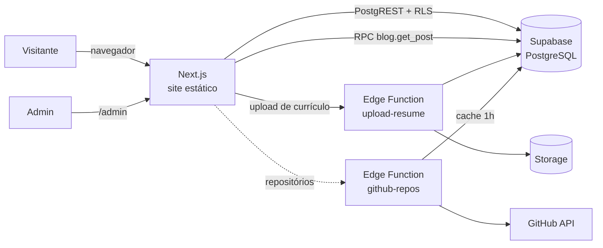

<div align="center">


# Dário Jr

**Desenvolvedor Full Stack** · São Paulo, SP · Remoto

React · Next.js · React Native · Swift · Node.js · PHP · AWS

[](https://birdra1n.com)
[](https://www.linkedin.com/in/ronisdario)
[](mailto:ronisdario@icloud.com)

</div>

---

Este repositório guarda o código do meu portfólio pessoal: um site em **Next.js** com conteúdo no **Supabase**, traduzido para **português, inglês e espanhol** e com um painel administrativo próprio para publicar projetos, artigos e experiência.

> Mais de 4 anos construindo produtos web e mobile de ponta a ponta, com foco em performance, testes e código fácil de manter.

## ✨ Destaques

| | |
|---|---|
| 🌎 **Três idiomas** | O site detecta o idioma do sistema (pt, en, es) e traduz a interface **e o conteúdo** — posts, projetos e experiência vêm do banco já no idioma certo, com fallback para o original. |
| 🧭 **Pensado para recrutadores** | A primeira dobra responde quem sou, o que faço, onde estou, há quanto tempo e como baixar meu currículo. Depois vêm experiência, projetos, stack, formação e contato. |
| 🎞️ **Movimento com propósito** | As animações respondem ao scroll e usam só `transform` e `opacity`. Quem usa `prefers-reduced-motion` recebe uma versão estática. |
| 🌗 **Tema claro e escuro** | O tema segue o sistema operacional. Os tokens de cor separam o amarelo usado em texto (com contraste no fundo claro) do amarelo usado em preenchimentos. |
| 🛠️ **CMS próprio** | Painel em `/admin` para projetos, posts, traduções, experiência, certificados, mensagens de contato, currículo e apps da AltStore. |
| 🔐 **Seguro por padrão** | RLS em todas as tabelas, URLs do banco sanitizadas, Markdown com `rehype-sanitize` e headers HTTP de segurança. |
| 🎮 **Arcade** | Dois minigames de digitação em `/play`, para treinar os dedos entre um commit e outro. |

## 🧰 Stack

<p>
  
  
  
  
  
  
  
  
</p>

- **Front-end:** Next.js (Pages Router), React, TypeScript, Tailwind CSS v4, Framer Motion, `next-themes`
- **Back-end:** Supabase (PostgreSQL com RLS, Auth, Storage, RPC) e Edge Functions em Deno
- **Conteúdo:** Markdown com `@uiw/react-md-editor` e sanitização via `rehype-sanitize`
- **Tipografia:** Inter, Inter Tight e JetBrains Mono, servidas pelo `next/font` (sem request externo)

## 🏗️ Arquitetura



O site é renderizado como páginas estáticas, e os dados chegam no navegador direto do Supabase. As decisões de acesso ficam no banco, por meio de **Row Level Security**: o público só enxerga conteúdo publicado e só o administrador escreve.

### Banco de dados

O banco é dividido em schemas por domínio:

| Schema | Tabelas | Para quê |
|---|---|---|
| `portfolio` | `projects`, `project_translations`, `experiences`, `experience_translations`, `certificates`, `organizations`, `categories`, `contact_messages`, `site_settings` | Conteúdo do portfólio |
| `blog` | `posts`, `post_translations`, `tags`, `post_tags`, `post_project_mentions` | Artigos e relações |
| `store` | `apps`, `app_versions`, view `altstore_source` | Fonte da AltStore (`/api/altstore/source.json`) |
| `admin` | `administrators` + funções `is_admin()` e `get_role()` | Autorização usada pelas policies |

Algumas decisões que fazem diferença:

- **Traduções em tabelas próprias** (`*_translations`, uma linha por idioma), com a coluna `locale` indicando o idioma original. Isso mantém o schema normalizado e o fallback simples.
- **`blog.get_post(slug, locale)`** devolve o post, as tags e os projetos citados já traduzidos, em **uma** chamada. Antes eram três requisições em série, porque o PostgREST não faz join entre schemas.
- **As listagens buscam só as colunas que os cards exibem**, sem o Markdown inteiro de cada post.
- **O cache do GitHub guarda um único snapshot**, garantido por um trigger. Antes ele acumulava cópias sem limite.

As migrations ficam versionadas em [`supabase/migrations`](supabase/migrations).

### Internacionalização

```
i18n/
├── index.tsx        # provider, detecção do idioma, formatação de data e número
└── locales/
    ├── pt.ts        # dicionário base (define o tipo)
    ├── en.ts
    └── es.ts
```

O idioma vem de `navigator.languages`, com fallback para inglês. A escolha manual fica salva no `localStorage`. Os dicionários são tipados a partir do português, então uma chave esquecida em `en` ou `es` vira erro de compilação. O conteúdo do banco usa o hook `useLocalizedData`, que espera o idioma real ser resolvido, cancela requisições obsoletas e refaz a busca quando o idioma muda.

## 📁 Estrutura

```
├── components/
│   ├── home/            # hero, sobre, experiência, habilidades, blog, contato
│   ├── motion/          # primitivas de animação (Reveal, CountUp, ScrollProgress…)
│   ├── admin/           # editor Markdown, painel de traduções, upload de currículo
│   ├── games/           # Typing Test e Space Typer
│   └── ui/              # design system usado pelo admin
├── config/              # perfil, navegação e fontes
├── hooks/               # useLocalizedData, useResume, useAdminEditor…
├── i18n/                # traduções da interface
├── layouts/             # layout público e layout do admin
├── pages/               # rotas (home, projects, blog, contact, play, admin, api)
├── styles/globals.css   # tokens de design (claro/escuro) e componentes
├── supabase/            # migrations e Edge Functions
├── types/database.ts    # tipos do banco
└── utils/content.ts     # leitura de conteúdo já no idioma pedido
```

## 🚀 Rodando localmente

**Pré-requisitos:** Node.js 20+ e um projeto no [Supabase](https://supabase.com).

```bash
git clone https://github.com/BirdRa1n/birdra1n.github.io.git
cd birdra1n.github.io
npm install
cp .env.example .env.local   # preencha com as chaves do seu projeto
npm run dev
```

Abra [http://localhost:3000](http://localhost:3000).

### Variáveis de ambiente

| Variável | Descrição |
|---|---|
| `NEXT_PUBLIC_SUPABASE_URL` | URL do projeto Supabase |
| `NEXT_PUBLIC_SUPABASE_ANON_KEY` | Chave pública (anon). É segura no navegador porque o RLS protege os dados |

### Banco e funções

```bash
supabase db push                                         # aplica as migrations
supabase functions deploy github-repos --no-verify-jwt   # dados públicos, só leitura
```

> Opcional: defina o secret `GITHUB_TOKEN` na função `github-repos` para aumentar o limite da API do GitHub.

### Scripts

| Comando | O que faz |
|---|---|
| `npm run dev` | Servidor de desenvolvimento (Turbopack) |
| `npm run build` | Build de produção |
| `npm run start` | Serve o build |
| `npm run lint` | ESLint com correção automática |

## 🔑 Painel administrativo

O painel fica em `/admin` (também acessível por `/dashboard`). O acesso exige login no Supabase Auth **e** um registro em `admin.administrators`. Por lá dá para:

- criar e editar **projetos** e **posts** em Markdown, com upload de imagens e as **traduções** em abas, marcadas como automáticas ou revisadas;
- manter a **linha do tempo** de experiência e formação;
- gerenciar **certificados**, **tags** e **apps** da AltStore;
- ler as **mensagens** enviadas pelo formulário de contato;
- enviar uma nova versão do **currículo**, que fica disponível para download no site.

## 📬 Contato

<div align="center">

**Ronisdário Alves Bezerra Jr.**

[birdra1n.com](https://birdra1n.com) · [LinkedIn](https://www.linkedin.com/in/ronisdario) · [GitHub](https://github.com/birdra1n) · [ronisdario@icloud.com](mailto:ronisdario@icloud.com)

<sub>Distribuído sob a licença [MIT](LICENSE).</sub>

</div>
